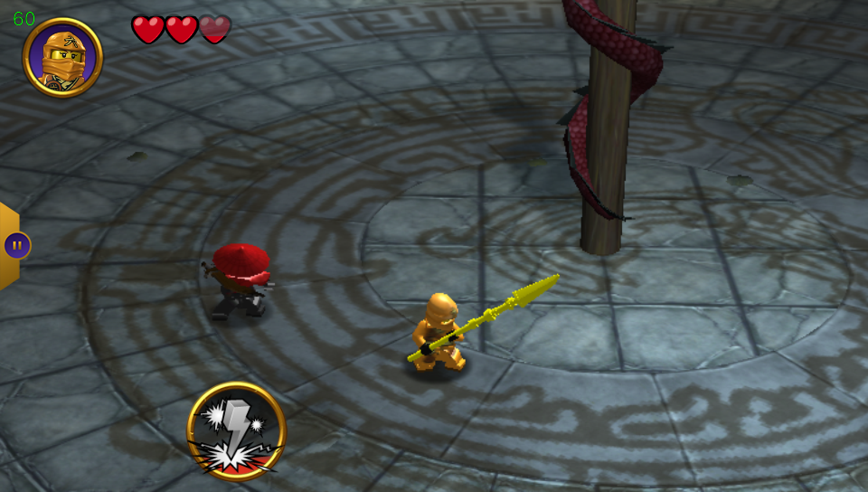
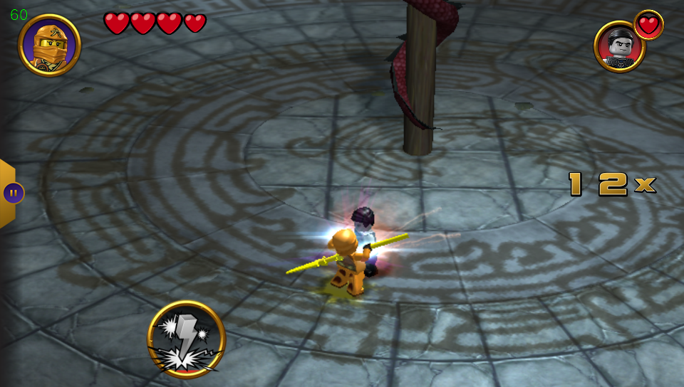

#AI Disclosure

This PS Vita port was fully built by AI under human direction, with human hardware testing. The original game and third-party components retain their respective authorship and credits.

# Ninjago Tournament for PS Vita

An Android ARMv7 compatibility port of LEGO Ninjago Tournament using vitaGL.
Release version: **1.00** (Vita SFO `01.00`).

Progressive player/boss heart depletion is confirmed working on a physical
Vita. The release keeps that renderer fix and provides separate normal and
logging-enabled packages; the packaging/logging changes need a device smoke test.
Loading delays and occasional gameplay stutters remain known limitations.

## Requirements

- A homebrew-enabled PS Vita with `kubridge.skprx` loaded.
- `libshacccg.suprx`, installed using ShaRKBR33D.
- Your own matching Android game files and approximately 1 GB of free storage.
- For building: WSL Ubuntu, CMake, Python 3 and the soft-float VitaSDK.

The supported Android release is `1.05.2.970`, versionCode **1057**. Do not mix
its executable with a different release's OBB. Verified source identities:

```text
APK: 4350837c447218109e4a72a8d19a2d3699f9440f9a759aab7f3843d7b54f2d80
OBB: a42a74b4a7a9c22c970cd504ce6463a070401d092605deb20fbf66f89b6dd1d4
```

## Install game data

From the repository root, prepare your legally supplied matching XAPK:

```bash
python3 scripts/prepare_data.py "/path/to/game.xapk" --output stage
```

Copy the contents of `stage/` to the Vita so these paths exist:

```text
ux0:data/ninjago/libLEGO_M1.so
ux0:data/ninjago/main.1057.com.lego.ninjago.toe.obb
ux0:data/ninjago/assets/obb_info.xml
```

Install the VPK using VitaShell. Game data, saves and caches live outside the
bubble in `ux0:data/ninjago/`; do not erase that directory when reinstalling.
If LiveArea artwork remains stale, uninstall only the old bubble and reinstall.

An optional arena cache can be prepared on the Vita by holding **L+R** during
launch when no valid cache exists. Preparation is skipped when the cache is
already valid. Normal operation does not require this cache, and copied cache
data must not be redistributed.

## Controls

| Control | Action |
| --- | --- |
| Left stick | Move; aim while holding Square in ranged mode |
| Right stick | Camera |
| D-pad | Menu navigation; movement when D-pad mode is selected |
| Cross | Jump / confirm |
| Square | Attack; hold for stationary ranged auto-fire |
| Circle | Dodge where supported / back |
| Triangle | Grab; press again to throw a grabbed enemy |
| L | Block; previous character page/game mode in menus |
| R | Special; next character page/game mode in menus |
| Select | Toggle melee/ranged for characters supporting ranged attacks |
| Start | Pause |
| Front touchscreen | Original touch controls and menus |

Character capabilities vary. Native controller navigation covers the main
menus, character selection, power-ups, prize draw and pause/quit dialogs.
Touch controls remain available. Saves stay in the game's normal data folder.

## Build the ELF

Run commands from the repository root. The executable and all Android-facing
dependencies require the AAPCS base/soft-float ABI (`-mfloat-abi=softfp`).
Do not substitute hard-float dependency archives.

First-time dependencies:

```bash
export VITASDK="$HOME/vitasdk-softfp"
export PATH="$VITASDK/bin:$PATH"
python3 scripts/build_softfp_deps.py
bash scripts/build_vitagl_scissor.sh
```

The renderer script builds the included pinned source with its correctness
patch in an isolated dependency tree. It does not modify the included source
or install into the SDK. See [renderer notes](docs/renderer.md).

Configure the normal build once, then build incrementally:

```bash
export VITASDK="$HOME/vitasdk-softfp"
export PATH="$VITASDK/bin:$PATH"
cmake -S . -B build \
  -DCMAKE_TOOLCHAIN_FILE="$VITASDK/share/vita.toolchain.cmake" \
  -DCMAKE_BUILD_TYPE=Release \
  -DNINJAGO_ENABLE_LOGGING=OFF \
  -DVITAGL_LIBRARY="$PWD/.deps-softfp/libvitaGL.a"
cmake --build build --target ninjago_vita -j"$(nproc)"
```

Output: `build/ninjago_vita`, the unstripped ELF. This target does not package
a VPK. Dependencies and build outputs are ignored by Git but retained locally.

## Package the normal VPK

The normal build disables persistent loader logging and startup artwork-hash
diagnostics. It neither creates nor clears an existing `loader.log`. Critical
error console messages and fatal-error dialogs remain available.

From the repository root, after the normal configuration above:

```bash
export VITASDK="$HOME/vitasdk-softfp"
export PATH="$VITASDK/bin:$PATH"
cmake --build build --target ninjago-vita.vpk-vpk -j"$(nproc)"
python3 scripts/verify_vpk.py build/ninjago-vita.vpk
```

Output: `build/ninjago-vita.vpk` (1.00).

## Optional logging VPK

This is an optimized Release build with loader logging enabled, not a slower
compiler Debug build. It writes a fresh `ux0:data/ninjago/loader.log` each boot.
Both variants use title ID `NINJA0001`: install one at a time; they share the
same data and saves. No configuration file or extra bubble is required.

From the repository root:

```bash
export VITASDK="$HOME/vitasdk-softfp"
export PATH="$VITASDK/bin:$PATH"
cmake -S . -B build-log \
  -DCMAKE_TOOLCHAIN_FILE="$VITASDK/share/vita.toolchain.cmake" \
  -DCMAKE_BUILD_TYPE=Release \
  -DNINJAGO_ENABLE_LOGGING=ON \
  -DVITAGL_LIBRARY="$PWD/.deps-softfp/libvitaGL.a"
cmake --build build-log --target ninjago-vita-debug.vpk-vpk -j"$(nproc)"
python3 scripts/verify_vpk.py --debug build-log/ninjago-vita-debug.vpk
```

Output: `build-log/ninjago-vita-debug.vpk` (1.00 Logging). To build only its
ELF, use `cmake --build build-log --target ninjago_vita -j"$(nproc)"`.
The verifier checks the embedded eboot, SFO, revision, logging mode, ABI and
LiveArea hashes. Keep the matching unstripped ELF when reporting a crash.

## Screenshots




## License and attribution

Original project code and project-specific modifications are licensed under
**LGPL-3.0-or-later**; see [LICENSE](LICENSE) and [COPYING](COPYING).
Third-party code retains its original licenses and copyright notices, including
the inherited loader's MIT notices in [licenses/](licenses/). This designation
does not relicense upstream code. See [THIRD_PARTY.md](THIRD_PARTY.md).
Game executables, expansion files, saves and
copied caches are not bundled. LEGO/WB artwork, screenshots, Android-loader
branding and trademarks are not covered by the project's code license; the
current artwork remains private-test material pending redistribution review.
